<p><picture><source media="(max-width: 600px)" srcset="assets/readme/hero-mobile.svg"/>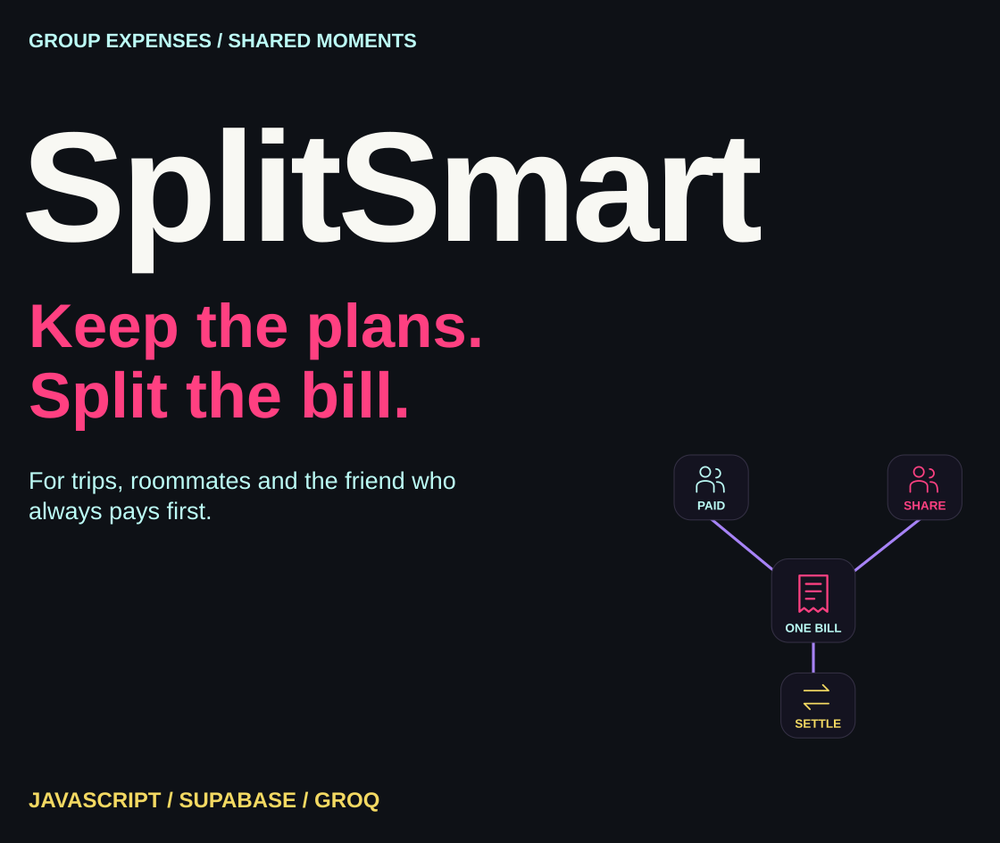</picture></p>

<p align="center"><a href="#what-i-built">Overview</a> · <a href="#from-bill-to-balance">Workflow</a> · <a href="#how-the-balances-work">Balances</a> · <a href="#set-up-the-project">Setup</a> · <a href="#screenshots-and-demo">Screenshots</a> · <a href="#explore-the-source">Source</a></p>

I built SplitSmart for the practical part of sharing a trip, a flat or a group plan: keeping track of who paid, how the bill is divided and what is still owed. Create a group, share its link and record expenses without a sign-up flow. Supabase stores the group records; the frontend calculates balances and offers a settlement list.

##  What I built

<p><picture><source media="(max-width: 600px)" srcset="assets/readme/features-mobile.svg"/>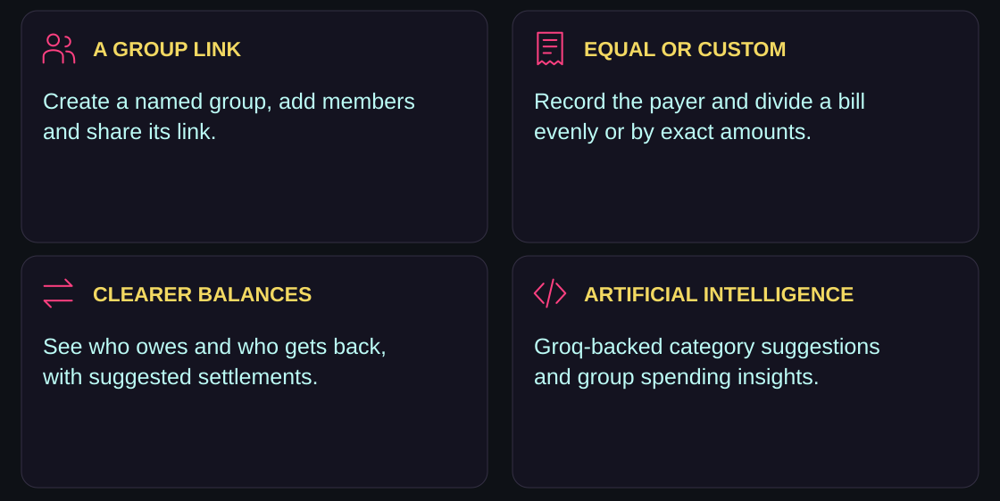</picture></p>

The interface includes expense history with category filters, deletion, category spending charts, payer rankings and settlement history. Groq supports category suggestions and generated spending insights; the financial calculations use the application’s JavaScript logic.

##  From bill to balance

<p><picture><source media="(max-width: 600px)" srcset="assets/readme/workflow-mobile.svg"/>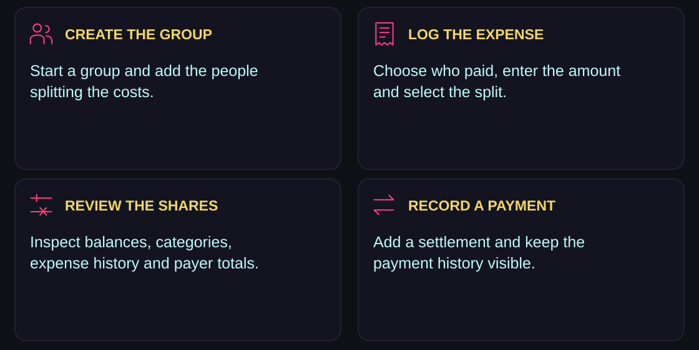</picture></p>

Share the generated group link so others can open that group. The application has no authentication or membership-permission layer. Treat group records as demonstration data unless you add suitable access controls.

##  How the balances work

<p><picture><source media="(max-width: 600px)" srcset="assets/readme/balances-mobile.svg"/>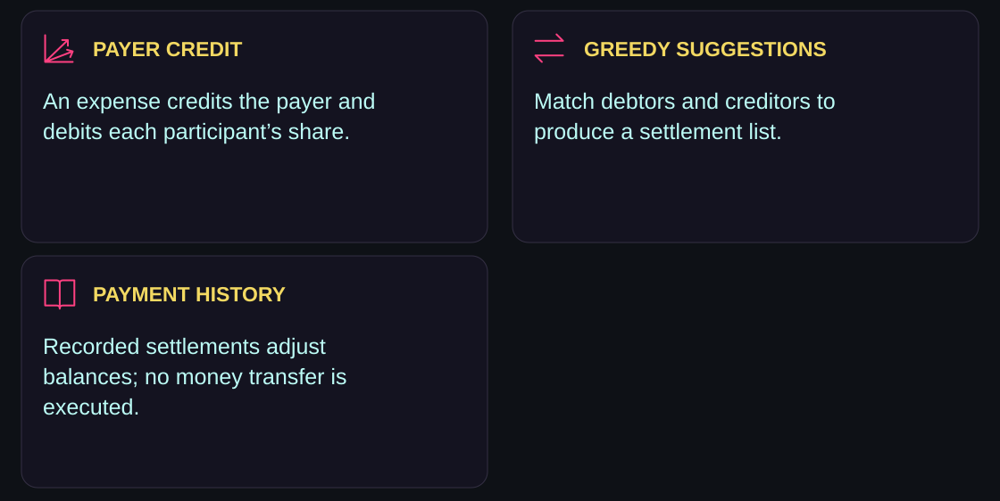</picture></p>

An expense credits the person who paid and debits participants by their stored shares. A recorded settlement raises the sender’s balance and lowers the receiver’s. The UI labels positive balances as “gets back,” negative balances as “owes,” and values within its small tolerance as settled.

The settlement list uses a greedy debtor/creditor matching algorithm. It simplifies outstanding balances into payment suggestions; it does not guarantee a globally minimum number of payments. Recording a settlement updates the ledger—it does not initiate a bank payment.

### Artificial Intelligence and live updates

Expense descriptions are debounced before a Groq request suggests one of seven categories: Food, Travel, Rent, Entertainment, Shopping, Utilities or General. The response is normalized against that list, with General as the fallback. The configured model is `llama-3.3-70b-versatile`; actual access depends on your provider account.

Supabase Realtime subscribes to the group’s **members, expenses and settlements** tables. Events trigger a fetch and re-render. The current code does not subscribe directly to all five schema tables, so changes to nested split rows alone may need a refresh.

##  Set up the project

<p><picture><source media="(max-width: 600px)" srcset="assets/readme/environment-mobile.svg"/>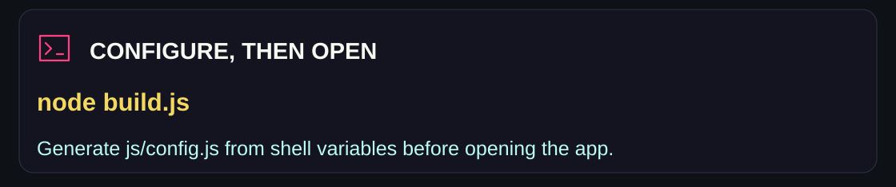</picture></p>

```bash
git clone https://github.com/adilsukumar/SplitSmart-Expense-Splitter.git
cd SplitSmart-Expense-Splitter
```

### Database

The application expects these Supabase tables:

| Table | Purpose |
|---|---|
| `expense_groups` | Group name and creation date |
| `members` | People associated with a group |
| `expenses` | Amount, payer, split type and category |
| `expense_splits` | Each participant’s share of an expense |
| `settlements` | Recorded payments between members |

<details>
<summary><strong>Existing demo schema</strong></summary>

The SQL below preserves the repository’s original demonstration setup. It disables row-level security and provides no private group membership model. Use an isolated test project with non-sensitive sample data; a public production deployment needs an access-control design rather than this configuration.

```sql
create table expense_groups (id uuid default gen_random_uuid() primary key, name text not null, created_at timestamp default now());
create table members (id uuid default gen_random_uuid() primary key, group_id uuid references expense_groups(id) on delete cascade, name text not null, created_at timestamp default now());
create table expenses (id uuid default gen_random_uuid() primary key, group_id uuid references expense_groups(id) on delete cascade, description text not null, amount numeric not null, paid_by uuid references members(id) on delete cascade, split_type text default 'equal', category text default 'General', created_at timestamp default now());
create table expense_splits (id uuid default gen_random_uuid() primary key, expense_id uuid references expenses(id) on delete cascade, member_id uuid references members(id) on delete cascade, amount numeric not null);
create table settlements (id uuid default gen_random_uuid() primary key, group_id uuid references expense_groups(id) on delete cascade, from_member uuid references members(id) on delete cascade, to_member uuid references members(id) on delete cascade, amount numeric not null, settled_at timestamp default now());
alter table expense_groups disable row level security;
alter table members disable row level security;
alter table expenses disable row level security;
alter table expense_splits disable row level security;
alter table settlements disable row level security;
alter publication supabase_realtime add table expense_groups;
alter publication supabase_realtime add table members;
alter publication supabase_realtime add table expenses;
alter publication supabase_realtime add table expense_splits;
alter publication supabase_realtime add table settlements;
```

</details>

Enable Realtime for the tables used by the subscriptions and inspect the connected project’s permissions before deployment.

### Generate browser configuration

The repository does not track `js/config.js`. Its [build script](build.js) generates it from environment variables. For example, in PowerShell:

```powershell
$env:SUPABASE_URL = "https://your-project.supabase.co"
$env:SUPABASE_ANON_KEY = "your-anon-key"
$env:GROQ_API_KEY = "your-groq-key"
node build.js
```

Open `index.html`, or serve the repository as a static site. There is no npm package-install step in this repository. Network access is still needed for Supabase, Groq and the frontend’s external resources.

**The generated configuration is browser-readable.** Putting `GROQ_API_KEY` in a deployment environment variable does not keep it secret once `build.js` writes it into JavaScript. Use a restricted test key for personal experiments; keeping a provider credential private requires moving those Groq requests behind a server endpoint. The current code has no such proxy.

### Vercel deployment

Import **SplitSmart-Expense-Splitter**, configure `SUPABASE_URL`, `SUPABASE_ANON_KEY` and `GROQ_API_KEY`, and use the repository’s existing [vercel.json](vercel.json): it runs `node build.js` and publishes the repository root. Verify the generated config and database connection. A repository does not need to be public merely to import it into a hosting account with access.

##  Current scope

<p><picture><source media="(max-width: 600px)" srcset="assets/readme/scope-mobile.svg"/>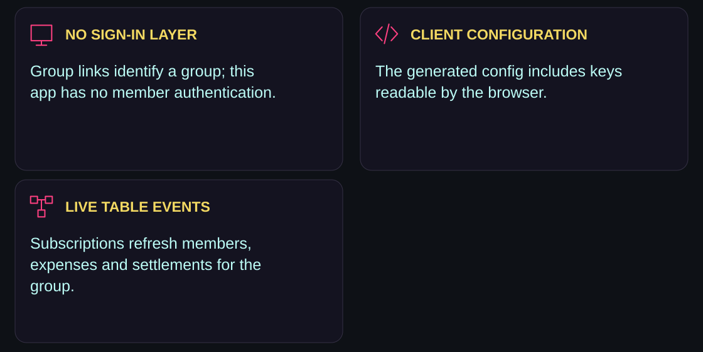</picture></p>

Group data is stored in the configured Supabase project. Expense descriptions and group information used for insights are sent to Groq. The original demo schema disables RLS, so a group URL is an identifier rather than a privacy boundary.

The current source displays rupee amounts and has no multi-currency conversion layer. Authentication, CSV/PDF export, recurring expenses, notifications and a PWA remain future ideas in the original README. They are not presented here as completed features.

##  Screenshots and demo

[Open the existing live-app link](https://splitsmart-finance.vercel.app/) · [Watch the existing demo video](https://drive.google.com/file/d/1ofJDoJqaGJ4o9unK8us7brOEEajMSBbo/view?usp=sharing)

<details>
<summary><strong>Original application screenshots</strong></summary>


</details>

##  Explore the source

<p align="center"><a href="js/app.js">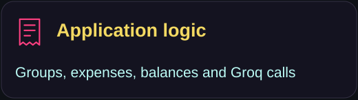</a> <a href="build.js">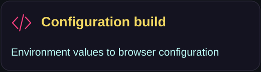</a> <a href="index.html">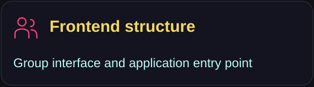</a> <a href="vercel.json">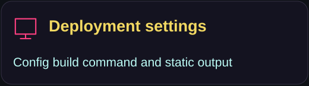</a></p>

```text
index.html       application interface and external resources
css/style.css    dashboard styling
js/app.js        groups, expenses, balance calculation and Groq requests
build.js         generates the untracked js/config.js
vercel.json      configuration build and static output
```

The repository currently has no automated test runner or package scripts. Inspect the balance logic and use an isolated sample group when validating changes.

<p><picture><source media="(max-width: 600px)" srcset="assets/readme/closing-mobile.svg"/>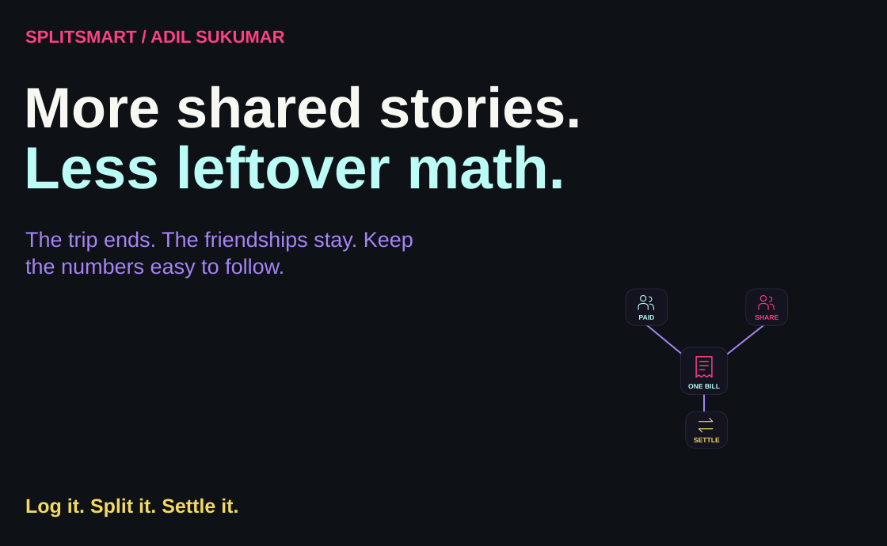</picture></p>

<p align="center"><a href="https://github.com/adilsukumar/SplitSmart-Expense-Splitter/issues">Discuss an improvement</a> · <a href="js/app.js">Inspect the balance logic</a> · <a href="https://www.adilsukumar.xyz/">Meet the builder</a></p>
